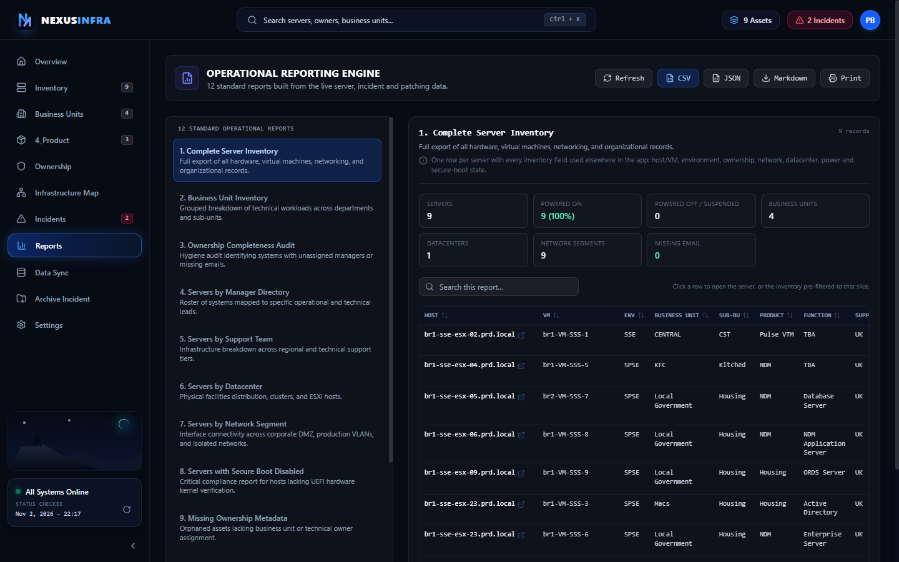

# Reports

> **At a glance:** The reporting engine turns live server, incident and patching data into 12 named operational reports — each with its own dataset, columns, summary cards and CSV/JSON/Markdown export.

| | |
|---|---|
| View id | `reports` |
| Sidebar label | `Reports` |
| Core component | `src/components/views/ReportsView.tsx` |
| Reporting engine | `src/services/reportEngine.ts` |
| Primary API | `GET /api/servers?limit=1000`, `GET /api/incidents`, `GET /api/patching/campaigns` |
| Primary users | SOC analysts, infrastructure owners, service managers, auditors |
| Depends on | Server inventory, active incidents, patch campaigns; `ServerDetailDrawer`; Inventory filters for drill-through |

## 1. What this page is for

Reports is the export and assurance surface of the CMDB. It answers questions that span the whole estate rather than a single host: what do we own, who owns it, where is it, what is exposed, what is being patched, and who must be contacted during an incident.

The page contains **12 standard reports**. Each report is a first-class definition in `src/services/reportEngine.ts`, not a filter applied to one generic table. That means the Complete Server Inventory, the Business Unit roll-up and the Patching Lifecycle report show genuinely different rows, columns, summaries and exports.

Every report can be searched, sorted by any column, and exported as CSV (Excel-friendly UTF-8), JSON, Markdown or printed. Exports contain exactly the rows currently visible after search and sorting.

## 2. Who uses it, and for what

| Task | Report | Where to click |
|---|---|---|
| Produce the full asset extract for an audit | 1. Complete Server Inventory | Report 1 → CSV |
| Show workload distribution by department | 2. Business Unit Inventory | Report 2 → row to open the slice in Inventory |
| Chase missing managers or emails | 3. Ownership Completeness Audit / 9. Missing Ownership Metadata | Report 3 or 9 → click a host |
| Find everything a named manager owns | 4. Servers by Manager Directory | Report 4 → click the manager row |
| Hand a support team its estate list | 5. Servers by Support Team | Report 5 → CSV or click the team row |
| Review a site or datacenter | 6. Servers by Datacenter | Report 6 → click the datacenter row |
| Check exposure of a VLAN / DMZ segment | 7. Servers by Network Segment | Report 7 → click the segment row |
| Evidence Secure Boot compliance | 8. Servers with Secure Boot Disabled | Report 8 → CSV |
| Brief stakeholders during an incident | 10. Incident Impact Summary | Report 10 → CSV/Markdown |
| Prioritise containment and hardening | 11. Vulnerability Assessment Posture | Report 11 → click a host |
| Run the weekly patch stand-up | 12. Patching Lifecycle Progress | Report 12 → sort by Overdue |

## 3. Screen walkthrough

**Header bar.** Title "OPERATIONAL REPORTING ENGINE" and a count of the standard reports. Actions, left to right: **Refresh** (reloads servers, incidents and campaigns), **CSV**, **JSON**, **Markdown**, **Print**. Export buttons are disabled while the current report has no rows.

**Report catalogue (left column).** All 12 reports with their title and description. Selecting one resets the search box and any column sort, then rebuilds the report from the loaded data. The selected report is highlighted in blue.

**Report header (right column).** The selected title, its description, the live record count, and a methodology note explaining exactly what the report includes or excludes. The note is the fastest way to confirm the report is showing what its title promises.

**Summary cards.** Four to six KPI cards per report, coloured by tone: green for healthy, amber for attention, rose for a failing control, slate for neutral. Examples: "Powered on 9 (100%)" for report 1, "Overdue targets" for report 12, "Critical / High" for report 10. Each card may carry a small hint.

**Search and sort.** "Search this report…" filters across every visible column of the current report. Clicking a column header sorts ascending; clicking again reverses. Numeric columns sort numerically. A small helper line explains that rows are clickable when the report supports drill-through.

**Table.** Rows are the report's own grain: servers for reports 1, 3, 8, 9 and 11; business-unit/sub-BU groups for 2; managers for 4; support teams for 5; datacenters for 6; networks for 7; incidents for 10; patch targets for 12. Missing values render as `—`. Severity, status, power and patch status render as coloured badges. Long lists (products, managers, BUs) are shortened to three values plus `+N`.

**Drill-through.** A row with a small blue arrow is clickable. A row tied to a server opens the Server Detail drawer. An aggregate row (BU, manager, support team, datacenter, network) opens Inventory pre-filtered to that slice. The cursor changes to a pointer only for clickable rows.

**Empty and loading states.** Loading shows "Loading reporting data…". An empty report shows its specific message, for example "Every server has a complete ownership record…" for report 3 or "No patch campaigns exist yet…" for report 12. An empty search result is distinguished from an empty report.

**Footer.** Data provenance counts (servers, incidents, campaigns) and the time the data was loaded. It is deliberately visible before you export, so a stale load is obvious.

## 4. Data shown

| # | Report | Row grain | Source | Selection logic |
|---|---|---|---|---|
| 1 | Complete Server Inventory | Server | `servers` | All servers; 19 columns covering hardware, network, ownership and org |
| 2 | Business Unit Inventory | BU + Sub-BU | `servers` | Grouped; powered on/off, products, managers, Secure Boot gaps |
| 3 | Ownership Completeness Audit | Server | `servers` | Servers missing any of manager, email, BU, sub-BU, support team; completeness % |
| 4 | Servers by Manager Directory | Manager | `servers` | Grouped; Unassigned bucket last |
| 5 | Servers by Support Team | Support team | `servers` | Grouped; environments, datacenters, missing emails |
| 6 | Servers by Datacenter | Datacenter | `servers` | Grouped; hypervisor hosts and network counts |
| 7 | Servers by Network Segment | Network | `servers` | One row per distinct network_1/2/3; servers counted once per segment |
| 8 | Servers with Secure Boot Disabled | Server | `servers` | `efi_secure_boot === false` only; unknown state summarised separately |
| 9 | Missing Ownership Metadata | Server | `servers` | Missing manager, email or business unit |
| 10 | Incident Impact Summary | Incident | `incidents` + `servers` | Active incidents only; affected servers resolved live |
| 11 | Vulnerability Assessment Posture | Server | `incidents` + `servers` | Incident severity, Secure Boot, ownership, power state; risk score ≥ 20 |
| 12 | Patching Lifecycle Progress | Patch target | `campaigns` + `servers` | Every target; overdue derived from campaign completion date |

Summary cards are computed from the same rows, so a card and the table can never disagree. Report 10 excludes `Closed` and `Archived` incidents by design; report 8 never treats `null` Secure Boot as disabled, but counts it as "Unknown state".

## 5. Common workflows

**1. Monthly compliance pack.**
1. Click **Refresh** to load the current data.
2. Open report 8, export CSV; note the "Unknown state" card and chase those hosts separately.
3. Open report 3, export CSV; assign fixes from the "Missing Fields" column.
4. Return to report 1 and export the full inventory as the evidence set.

**2. Ownership cleanup sprint.**
1. Open report 9 to get the short list of orphaned assets.
2. Click a row to open the Server Detail drawer and copy the host/IP into a data-quality ticket.
3. After the import, refresh and confirm report 9 is empty, then check report 3 for partial records (sub-BU or support team still missing).

**3. Incident stakeholder pack.**
1. Open report 10; confirm the incident count matches the active incidents in the Incidents view.
2. Export **Markdown** for the incident channel or **CSV** for the stakeholder tracker.
3. Use the "Stakeholder Emails" and "Managers" columns to build the contact list. To generate the templated mail, open the affected hosts in Inventory and use its bulk **Contact List** action (Communications is not reachable from the incident itself).

**4. Weekly patch stand-up.**
1. Open report 12 and sort by **Overdue** descending.
2. Read "Remediated %", "Overdue targets" and "Campaigns at risk" from the cards.
3. Export CSV and assign the overdue rows to the engineer named on each row.

**5. Ad-hoc slice.**
1. Open report 2, 4, 5, 6 or 7.
2. Search or sort to the slice you need.
3. Click the row to jump to Inventory with the filters already applied, then use Inventory's own bulk actions (incident, communications, CSV) on that population.

## 6. Gotchas and guardrails

- Viewers only have reports 1–9 and 12. The incident-derived reports 10 and 11 are hidden and are not even fetched without incident access.
- Reports are a snapshot of the last load, not a live feed. Press **Refresh** after importing data or changing incidents; the footer timestamp tells you how old the snapshot is.
- The loader requests `limit=1000`. Beyond 1,000 servers the inventory-based reports are truncated. This is the same ceiling used elsewhere in the app; paginate or raise the limit deliberately if the estate grows.
- Report 3 and report 9 can legitimately be empty on a clean estate. That is a pass, not a broken report — the empty message says so.
- Report 10 counts server links, not unique servers. A server in two active incidents appears in both rows and counts twice in "Affected server links"; use "Unique affected servers" for the true figure.
- Report 11's threshold is a heuristic. A Low-severity incident scores 20 and is included deliberately, so no incident-linked host is hidden. Scores cap at 100.
- Report 12 treats `Patched`, `Validated` and `Exception granted` as complete. `Affected`, `Scheduled`, `In progress`, `Not assessed` and `Validation required` remain open, and become overdue the day after the campaign completion date.
- Exports reflect the current search and sort, not the entire dataset. Clear the search before exporting a full report.
- Clicking **Print** prints the browser view of the page, including the app chrome. Use the CSV/Markdown exports for anything that must be filed.
- Report selection, search and sort are not persisted in the URL; a page refresh returns to report 1.

## 7. For developers

**Architecture.** `src/services/reportEngine.ts` is the single source of truth. `REPORT_DEFINITIONS` holds metadata (id, title, description, methodology note, columns, empty message). `buildReport(id, dataset)` dispatches to one builder per report and returns `{ definition, rows, summary, generatedAt }`. `ReportsView.tsx` is presentation only: it fetches, calls `buildReport`, then applies `filterReportRows` and `sortReportRows`.

**Row contract.** Rows are `Record<string, string | number>` keyed by column key. Two internal keys are stripped from exports: `_serverId` (opens the server drawer) and `_drill` (a filter dictionary forwarded to Inventory). Dates are ISO `YYYY-MM-DD`; lists are comma-joined and capped by `formatList`.

**Dataset.** `ReportDataset` is `{ servers, incidents, campaigns, now? }`. `now` is injectable so report 12's overdue logic is deterministic in tests. Builders never mutate the dataset; they copy and sort new arrays.

**Adding or changing a report.**
1. Add or edit the definition in `REPORT_DEFINITIONS` (title, description, note, columns, empty message).
2. Add a builder function and wire it into the `switch` in `buildReport`. Keep the grain consistent with the title; aggregate rows must use `num()` cells for counts so numeric sorting works.
3. Add a check to `scripts/verify-reports.ts` that asserts the semantics (filter, grouping, totals, empty case). Run `npm run verify:reports`.
4. Update this page's tables in report 4 and the workflows if the user-facing meaning changed.

**Exports.** `reportToCsv` emits a UTF-8 BOM, quoted cells and CRLF for Excel. `reportToJson` emits report metadata, summary and rows with internal keys removed. Markdown export is assembled in the view from the same visible rows.

**Styling.** Badges are mapped by value in `badgeClass` (severity, incident status, power state, Secure Boot, patch status). Summary tones use `toneClass`. If you add a new status word, extend `badgeClass` rather than colouring cells inline.

**Verification.** `npm run lint` typechecks; `npm run verify:reports` builds all 12 reports against `data/csm_database.json`, asserts per-report semantics, and exercises synthetic edge cases (ownership gaps, closed incidents, overdue patch targets, empty database). `npm run build` confirms the bundle.

## 8. Related pages

- [Inventory](./02-inventory.md) — where every drill-through lands, and the source of the 1,000-row dataset.
- [Incidents](./07-incident-triage.md) — the active incidents behind report 10 and the risk drivers in report 11.
- [Archive Incident](./08-archived-incidents.md) — why closed incidents disappear from report 10.
- [Data Sync](./11-data-management.md) — how servers, incidents and campaigns get into the reports.
- [Overview](./01-overview.md) — the headline KPIs that reports drill into.
