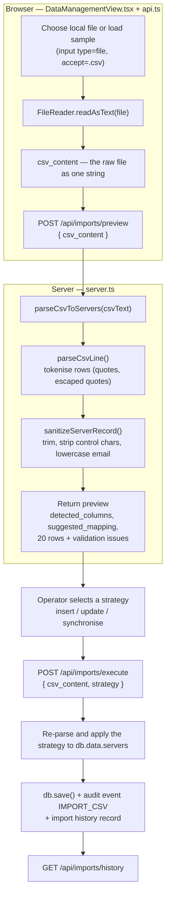

# Data Sync (Import & Data Management)

> **At a glance:** The five-stage CSV import engine — upload, column mapping, hygiene preview, strategy choice, summary — plus the full import history and the demo-data reset.

| | |
|---|---|
| View id | `data-management` |
| Sidebar label | `Data Sync` |
| Core component | `src/components/views/DataManagementView.tsx` |
| Primary API | `POST /api/imports/preview` |
| Primary users | Data managers, infrastructure owners and the CMDB administrator who receive the monthly CSM extract |
| Depends on | `parseCsvToServers` and `sanitizeServerRecord` in `server.ts`; `data/csm_database.json`; the sample CSV under `public/assets/aistudio/` |

## How it works

The client never sends a multipart file — it reads the whole CSV into a string with `FileReader.readAsText` and posts that string as JSON. The preview endpoint parses it with `parseCsvToServers` (which uses `parseCsvLine` to tokenise each row) and normalises every field through `sanitizeServerRecord`, then returns the detected columns, a suggested column mapping, and up to 20 validated preview rows. On execute, the same parsing runs again and the chosen strategy — `insert`, `update`, or `synchronise` — is applied to the in-memory server list before the database is written and a single `IMPORT_CSV` audit event is recorded.

## 1. What this page is for

This is the only page that changes inventory in bulk. It takes a CSV export from the CSM source, shows what the importer understood, flags rows with hygiene problems, asks how existing records should be treated, and writes the result. Every run is recorded in the history table at the bottom of the page and as a single audit event.

The page is a wizard, not a form: each stage must be reached in order from the previous one, and there is no way to edit values mid-flight. If the data is wrong, fix the CSV and start again.

## 2. Who uses it, and for what

| Task | Where to click |
|---|---|
| Import a fresh CSM extract | **Choose Local File** in Stage 1 |
| Try the flow without a real file | **Load Sample CSM Dataset** in Stage 1 |
| Check how a CSV header was interpreted | Stage 2, the `→ mapped_field` badge next to each column |
| See which rows would be rejected or warned | Stage 3, the **Validation Issues** column |
| Choose how existing records are treated | Stage 4, the three strategy cards |
| Commit the import | Stage 4, **Execute Import Now** |
| Read the outcome counts | Stage 5 tiles |
| Audit a previous import | **Historical Import Audits (n)** table |
| Restore the demo data | **Reset to Demo Seed** in the header |

## 3. Screen walkthrough

**Header.** The title **DATA MANAGEMENT & 5-STAGE CSV IMPORT ENGINE** with a subtitle, and a single action on the right: **Reset to Demo Seed**.

**Stepper.** A five-cell strip that always shows all stages: **Upload CSV**, **Column Mapping**, **Hygiene Preview**, **Import Strategy**, **Summary & Audit**. The current stage is blue, completed stages are green with a tick, future stages are grey. The strip is an indicator only — the cells are not clickable.

**Stage 1 — Upload CSV.** A centred panel: "Upload Infrastructure CSV Inventory", the hint that the file must be UTF-8 CSV, a **Choose Local File** button (a styled `<label>` wrapping a hidden `input type="file"` accepting `.csv,text/csv`) and a secondary **Load Sample CSM Dataset** button that fetches the bundled mockup from `/assets/aistudio/`. Choosing a file reads it with `FileReader.readAsText` and immediately calls the preview endpoint.

**Stage 2 — Column Mapping.** Headed "Stage 2: Automatic Field & Column Mapping", with the explanatory line "Verify detected CSV headers mapped into normalized CSM entities (e.g. 6_Environmen → business_environment)". Every detected header is listed in a three-column grid as `column → target_field`, or `→ unmapped`. There are no dropdowns: the mapping is display-only. Buttons: **Back**, **Continue to Preview**.

**Stage 3 — Hygiene Preview.** Headed "Stage 3: Data Hygiene Validation (First 20 Records)". A table with columns **Row**, **Host**, **VM**, **Business Unit**, **Manager**, **Email**, **IP Address** and **Validation Issues**. Missing host renders **MISSING** in red, a missing manager renders **UNASSIGNED**, a missing email renders **MISSING**. The issues cell shows "Valid" with a tick, or an amber warning triangle plus the comma-joined issue list. Buttons: **Back**, **Select Strategy**.

**Stage 4 — Import Strategy.** Three radio cards, each labelled with a mode number, selected by clicking anywhere on the card:

- **Mode 2: Update Existing & Insert New Records (Recommended)** — default.
- **Mode 1: Insert New Records Only** — "Skips duplicates and preserves existing records exactly as they are".
- **Mode 3: Synchronise & Flag Disappeared Assets** — "flags missing records as potentially decommissioned (never deletes)".

Buttons: **Back**, and **Execute Import Now**, which becomes **Executing Import...** and disabled while the request runs. There is no confirmation dialog.

**Stage 5 — Summary & Audit.** Headed **Import Completed Successfully**, with six tiles: **Processed**, **New Records**, **Updated**, **Duplicates**, **Failed** and **Strategy**. One button: **Import Another File**, which returns to Stage 1 and clears the file and summary but keeps the history.

**Historical Import Audits (n).** A table of every recorded run: **File**, **Date**, **User**, **Strategy**, **Total**, **New**, **Updated**, **Status**. New counts are prefixed with `+`. There is no empty-state message: with no history the panel renders the heading with `(0)` and a header row.

**Errors.** Any thrown request surfaces as a red banner above the stage body, carrying the server's `error` string when one exists.

## 4. Data shown

| UI label | Source field / API | Notes |
|---|---|---|
| Detected columns | `detected_columns` from `POST /api/imports/preview` | The raw header line, trimmed |
| `→ mapped_field` | `suggested_mapping` | Header-name heuristics; never submitted back |
| Row | `preview[].row_number` | 1-based index within the preview, not the file line |
| Host / VM / Business Unit / Manager / Email / IP | `preview[].server.*` | Server fields already sanitised by the server |
| Validation Issues | `preview[].issues` | Up to six checks, see section 6 |
| Processed | `summary.total_records` | Rows parsed from the CSV |
| New Records | `summary.new_records` | |
| Updated | `summary.updated_records` | |
| Duplicates | `summary.duplicate_records` | |
| Failed | `summary.failed_records` | Rows missing host or VM |
| Strategy | `summary.strategy` | `insert`, `update` or `synchronise` |
| History rows | `GET /api/imports/history` | Newest first; the server unshifts each run |
| History User | `summary.user` | Hard-coded as `SecOps Administrator` by the client |

## 5. Common workflows

**Run a standard monthly refresh.**

1. Do **not** click **Reset to Demo Seed** for a routine refresh. Go straight to **Choose Local File** and pick the CSM extract.
2. On Stage 2, scan the right-hand column for `→ unmapped` entries. Rename those headers in the CSV if they carry data you need, then upload again.
3. On Stage 3, read **Validation Issues**. Fix missing managers and emails at source where possible; the import will still accept those rows.
4. On Stage 4, keep **Mode 2: Update Existing & Insert New Records**.
5. Click **Execute Import Now**.
6. On Stage 5, check **Updated** equals roughly the number of rows you expected to change and that **Failed** is zero. Note the strategy and the counts, then click **Import Another File** if you have more to load.

**Choose a strategy deliberately.**

1. **Mode 1 (Insert only)** — a first load or a strictly additive feed. Existing host+VM pairs are counted as duplicates and skipped entirely.
2. **Mode 2 (Update)** — the normal refresh. Matched records are merged; unmatched rows are inserted.
3. **Mode 3 (Synchronise)** — you want the importer to mark everything absent from this file as `is_missing_from_source`. Use it when the extract is known to be complete, because any server missing from the file is flagged, not deleted.

**Audit what happened last month.**

1. Scroll to **Historical Import Audits**.
2. Compare the **Strategy** and **New**/**Updated** columns across runs.
3. Cross-check the same window in Settings & Audit, filtering for `IMPORT_CSV`.

**Restore the demo dataset.**

1. Click **Reset to Demo Seed**.
2. Confirm the browser dialog: "Are you sure you want to re-seed the database to the initial 9 CSM records?"
3. Accept the follow-up "Database successfully restored to original seed inventory." alert.
4. The header counters refresh; a new `INITIAL_IMPORT` history row replaces the previous history.

## 6. Gotchas and guardrails

- Data Sync is visible only to `manager` and `admin`; the imports API returns `403` for viewers and analysts.

**Destructive behaviour.**

- **Reset to Demo Seed** replaces the entire server table with nine seed records and also overwrites incidents, patch campaigns, audit logs and import history. It is not a targeted rollback, and there is no audit entry recording that it happened.
- Mode 2 and Mode 3 overwrite every mapped field on a matched record. An empty cell in the CSV blanks the corresponding field in the database; the importer does not treat blank as "leave unchanged".
- Mode 3 never deletes, but it silently sets `is_missing_from_source` on every unmatched record. Importing a partial CSV with **Synchronise** selected will flag most of the estate as disappeared.

**Data quality.**

- Records are matched on the composite key `host::vm`, both lowercased. A VM renamed at source arrives as a new record; the old one remains and, under Mode 3, is flagged as missing.
- Validation only looks at the first 20 data rows. Everything beyond row 20 is imported unchecked — including rows with no IP or no business unit.
- The duplicate-host check in preview tests `host` alone, while execute matches `host::vm`. A second VM on an already-known host shows "Duplicate host in existing database" in Stage 3 and is then inserted as new.
- `unchanged_records` is never incremented, so the field is always `0` in history and is not shown in the UI.
- Rows with a missing host or VM are skipped and counted as failed. The per-row error detail is stored on the history item but is not rendered anywhere.
- Mode 1's promise to leave existing records untouched applies only to records that already exist. Duplicate rows inside a single file are pushed twice, because the in-run key index is not updated after an insert.

**Operational limits.**

- The whole file is sent as JSON in one request; Express is configured for a 50 MB body. Very large extracts should be split.
- The user string is hard-coded to `SecOps Administrator`; there is no field to attribute a run to a different operator.
- History is capped only by disk — 500 audit events are retained, but import history is kept indefinitely.

## 7. For developers

**Component structure.** One function component, `DataManagementView`, driven by a union-typed `currentStage` (`1 | 2 | 3 | 4 | 5`). Each stage is a separate JSX block guarded by `currentStage === n`; there are no child components and no router integration.

**Props.**

| Prop | Type | Purpose |
|---|---|---|
| `onRefreshData` | `() => void` | Called after a successful import and after a seed reset; `App.loadDashboardData` re-fetches `/api/stats`, `/api/audit-logs` and `/api/incidents` to refresh the navbar and sidebar counters |

**Local state.**

| State | Initial | Notes |
|---|---|---|
| `currentStage` | `1` | Advanced by **Continue**, **Select Strategy**, execute and reset |
| `csvContent` | `''` | Full file text; re-sent on execute |
| `filename` | `'csm_import.csv'` | Actual file name, or the sample file's name |
| `detectedColumns`, `columnMapping`, `previewRows`, `totalRows` | `[]`, `{}`, `[]`, `0` | Straight from the preview response; `totalRows` is stored but never rendered |
| `strategy` | `'update'` | |
| `importSummary` | `null` | Drives Stage 5 |
| `history` | `[]` | |
| `loading`, `errorMessage` | `true`/`false`, `null` | Errors are caught per action |

**Effects and calls.**

| Trigger | Call | Response |
|---|---|---|
| Mount | `GET /api/imports/history` | `ImportHistoryItem[]` |
| File chosen or sample loaded | `POST /api/imports/preview` `{ csv_content }` | `{ total_rows, detected_columns, suggested_mapping, preview[] }`; `preview[]` items are `{ row_number, server, issues, has_warnings }` |
| **Execute Import Now** | `POST /api/imports/execute` `{ csv_content, filename, strategy, user }` | `{ summary: ImportHistoryItem, total_in_database: number }` |
| After execute | `GET /api/imports/history` and `onRefreshData()` | |
| **Reset to Demo Seed** | `POST /api/seed/reset` | `{ success, count }`; then `onRefreshData()` and a history reload |

**Server-side import semantics.** `parseCsvToServers` maps columns by exact header name (`Host`, `VM`, `Support Team`, `PowerState`, `Primary IP Address`, `1_BusinessUnit`, `2_SubBusinessUnit`, `4_Product`, `5_Function`, `6_Environmen`, `7_OrganisationShortCode`, `8_OrganisationAbbreviated`, `Datacenter`, `Network #1–3`), with a lowercase alternative accepted for most fields. Every row passes through `sanitizeServerRecord`, which strips NUL, zero-width and BOM characters, removes carriage returns, trims, lowercases `email`, defaults `power_state` to `poweredOn`, coerces `efi_secure_boot` to `true`/`false`/`null` from `TRUE`/`FALSE`, regenerates a UUID when `id` is absent, and stamps `updated_at` with the current time. `imported_at` is also set to parse time, so an update overwrites the original first-seen date.

Strategy handling in `POST /api/imports/execute`:

- `insert` — if the key exists, `duplicate_records++`; otherwise push and `new_records++`.
- `update` — if the key exists, replace with `{ ...old, ...row, id: old.id, updated_at: now }` and `updated_records++`; otherwise push and `new_records++`.
- `synchronise` — as `update`, plus `is_missing_from_source: false`; afterwards every stored record whose key was not processed gets `is_missing_from_source = true`.
- Every run appends an `ImportHistoryItem` (`status` is `Completed with warnings` when `failed_records > 0`) and writes exactly one audit event: `db.logAudit(user, 'IMPORT_CSV', 'INVENTORY', <history id>, null, null, 'Imported N records (<strategy>): X new, Y updated')`. Preview writes no audit event. No event is written for a seed reset.

**Cross-view navigation.** None. The page never switches view or passes filters; it only calls `onRefreshData`.

**Extension points and rough edges.**

- `columnMapping` is decorative. Making Stage 2 editable requires sending the mapping to `/imports/preview` and `/imports/execute`, which currently ignore it.
- The Stage 5 heading is unconditional, so a run with failed rows still reads "Import Completed Successfully".
- `totalRows` and `summary.errors` are captured but never displayed; both are candidates for surfacing.
- There is no dry-run count of affected records before execute, and no confirmation step for Mode 3.
- `loadDefaultMockup` fetches a hard-coded `/assets/aistudio/...` path; renaming the asset breaks the sample button with a generic error banner.

## 8. Related pages

- [Inventory](./02-inventory.md) — where imported records land and where field-level corrections are made.
- [Infrastructure Map](./06-infrastructure-map.md) — the fastest way to spot a bad `datacenter` or network value after an import.
- [Ownership Explorer](./05-ownership-explorer.md) — shows ownership gaps that a CSV import can fix or introduce.
- [Settings & Audit](./12-settings-and-audit.md) — the `IMPORT_CSV` events written by each run.
- [Overview](./01-overview.md) — the completeness counters that should move after a good refresh.
